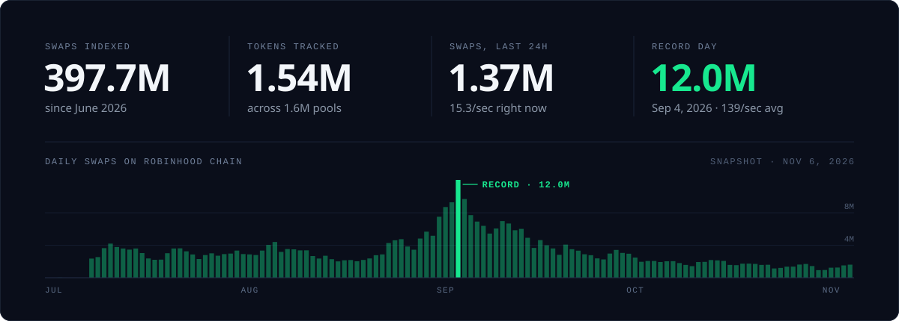

Bakuya Labs builds realtime market data and trading software: scanners, trading terminals, and the low-latency data feeds behind them.

### Now shipping

**[TopBlast](https://topblast.gg/new-pairs)** is a realtime token scanner and trading terminal for Robinhood Chain. It watches every pool on the chain and flags new launches, session highs and lows, and the first breakout of every run, in the block it happens. Live charts, a screener, a wallet tracker and one-click trading, all in the browser.

Under the hood, TopBlast runs its own Robinhood Chain node and indexes every pool on the chain into a 317 GB TimescaleDB: 397.7M swaps and over a billion token transfers since June 2026. Today it processes about 16 swaps a second; on its record day it processed 12.0M swaps, an average of 139 a second.

**[Open TopBlast](https://topblast.gg)** · [Follow @_topblastgg on X](https://x.com/_topblastgg)

### Stack

`TypeScript` `Node.js` `Python` `Cloudflare Workers` `AWS`

---

Bakuya Labs · New York, NY · [bakuyalabs.com](https://bakuyalabs.com)
